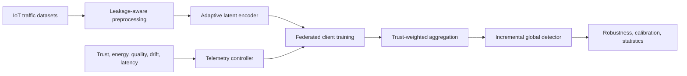

# EcoTrust-FLIDS

> Trust-aware, energy-conscious federated intrusion detection for heterogeneous IoT environments.

[](https://www.python.org/)
[](https://pytorch.org/)
[](evidence/README.md)
[](#research-boundaries)

EcoTrust-FLIDS is a reproducible research implementation for incremental federated intrusion detection. It combines adaptive latent representations, trust-weighted aggregation, continual adaptation, malicious-client robustness, and a deterministic telemetry controller that balances participation quality against modeled energy and communication cost.

**Interactive research demonstrator:** [DeepakVermaLab.github.io/EcoTrust-FLIDS-Simulation](https://deepakvermalab.github.io/EcoTrust-FLIDS-Simulation/)

## What this repository contains

- A complete staged notebook pipeline from environment audit through final statistics.
- Modular Python implementations for data preparation, latent embedding, federated learning, controller logic, energy estimation, explainability, and evaluation.
- Matched recent baselines, multi-seed confidence intervals, paired significance tests, and effect sizes.
- Non-IID, client-dropout, scalability, temporal drift, forgetting, malicious-client, and cross-dataset studies.
- Resource, communication, memory, controller-overhead, and modeled-energy comparisons.
- Durable resume/checkpoint support and compact accepted manifests for Stages 05-15.
- A verified 2023-2026 literature index with DOI/BibTeX mapping. Downloaded publisher PDFs are intentionally not redistributed.

## Method overview



The controller is deterministic and rule-based. It is not presented as a reinforcement-learning policy or general-purpose reasoning agent. Stage 14 separately compares static, random, round-robin, telemetry-heuristic, and learned selection policies under matched budgets.

## Repository map

```text
.
|-- configs/                 # local, Colab, and frozen publication protocols
|-- docs/                    # methodology, execution, and registry documentation
|-- evidence/                # accepted manifests and compact final statistics
|-- notebooks/               # stages 00-15 plus registered parallel shards
|-- paper/LS/                # literature index, DOI mapping, and BibTeX
|-- scripts/                 # execution, sharding, and synchronization helpers
|-- src/ecotrust/            # reusable implementation package
|-- tests/                   # protocol and regression tests
|-- deployment/              # evidence-backed simulation source and QA assets
|-- pyproject.toml
`-- requirements*.txt
```

Generated datasets, Parquet matrices, checkpoints, trained model binaries, caches, and downloaded literature PDFs are excluded from Git.

## Datasets

The frozen protocol evaluates three heterogeneous IoT intrusion-detection datasets:

1. **Edge-IIoTset**
2. **TON_IoT** — configured network/processed subset only
3. **CICIoT2023**

Dataset files are not included. Configure their local or Drive paths in `configs/project.json` or `configs/project_colab.json` before running an audit.

## Installation

```bash
git clone https://github.com/DeepakVermaLab/EcoTrust-FLIDS.git
cd EcoTrust-FLIDS

python3 -m venv .venv
source .venv/bin/activate
python -m pip install --upgrade pip
python -m pip install -r requirements-core.txt
python -m pip install -r requirements-ml.txt
python -m pip install -e .
```

Use `requirements-core.txt` for audit, preprocessing, and classical baselines. Install `requirements-ml.txt` for embedding and federated stages.

## Experiment pipeline

| Stage | Notebook | Purpose |
|---:|---|---|
| 00 | `00_environment_setup.ipynb` | Environment and dependency verification |
| 01 | `01_dataset_audit.ipynb` | Dataset inventory, schema, and label audit |
| 02 | `02_preprocessing_and_client_splits.ipynb` | Preprocessing and federated client partitions |
| 03 | `03_baseline_models.ipynb` | Classical matched baselines |
| 04 | `04_evotrust_embedding.ipynb` | Adaptive latent embedding |
| 05 | `05_incremental_federated_learning.ipynb` | Incremental trust-weighted FL |
| 06 | `06_agentic_energy_controller.ipynb` | Telemetry-driven client selection |
| 07 | `07_ablation_and_drift_analysis.ipynb` | Component ablations and controlled shift |
| 08 | `08_sync_outputs_to_drive.ipynb` | Reproducibility artifact audit |
| 09 | `09_recent_baselines_and_multiseed.ipynb` | Recent baselines and multi-seed evaluation |
| 10 | `10_non_iid_dropout_scalability.ipynb` | Non-IID, dropout, straggler, and scale studies |
| 11 | `11_temporal_drift_and_forgetting.ipynb` | Temporal streams and forgetting |
| 12 | `12_malicious_client_robustness.ipynb` | Poisoning and Byzantine robustness |
| 13 | `13_cross_dataset_controller_generalization.ipynb` | Leave-one-dataset-out policy transfer |
| 14 | `14_resource_energy_policy_comparison.ipynb` | Resource and policy comparison |
| 15 | `15_final_statistics_and_reproducibility.ipynb` | Final statistics and evidence ledger |

Publication runs use the frozen registry in `configs/publication_experiments.json`. Long-running stages write atomic progress and checkpoint artifacts and support `resume=True`.

## Command-line smoke checks

```bash
python -m ecotrust.cli audit
python -m ecotrust.cli preprocess --dataset Edge-IIoTset --mode smoke
python -m ecotrust.cli baseline --dataset Edge-IIoTset --mode smoke
python -m ecotrust.cli fed --dataset Edge-IIoTset --mode smoke
python -m ecotrust.cli agent --dataset Edge-IIoTset --mode smoke
```

## Verification

```bash
PYTHONPATH="$PWD/src" python -m pytest -q
python -m compileall -q src tests
```

Accepted completion evidence and compact final statistics are documented in [`evidence/README.md`](evidence/README.md). Notebook output is retained where available, but completion claims are based on manifests and required artifact checks—not printed output alone.

## Research boundaries

- The primary implemented task is **binary intrusion detection**. Per-attack recall/FNR does not constitute multiclass attack classification.
- Energy values are **model-estimated**, not direct hardware power measurements.
- The controller is deterministic and telemetry-driven; stronger agentic-learning claims are not made.
- Custom controls in the public simulator are transparent **what-if** calculations, not newly validated detector results.
- Negative, failed, null, and non-significant outcomes are preserved. Most macro-F1/attack-F1 comparisons against Stage-09 baselines are not significant after Holm correction.
- Early near-perfect baseline scores require a dedicated duplicate-flow/leakage/split-separation audit before strong superiority claims.

## Literature index

`paper/LS/` contains a verified 48-paper journal index for 2023-2026, including DOI selection, BibTeX, metadata, indexing verification, and source mapping. The PDFs are excluded to respect publisher redistribution conditions.

## Reproducibility notes

- Use `configs/project_colab.json` for Drive-mounted Colab execution and `configs/project.json` for local path configuration.
- Preserve the registered seeds, splits, metrics, and test-access rules.
- Do not tune on the held-out test data.
- Preserve failed and interrupted manifests when repairing an implementation defect.

## Citation

The formal paper citation will be added after publication. Until then, cite the repository name, commit hash, and access date.

## Access

This is the private full implementation repository. The separately published simulator contains only sanitized, compact evidence suitable for public inspection.
